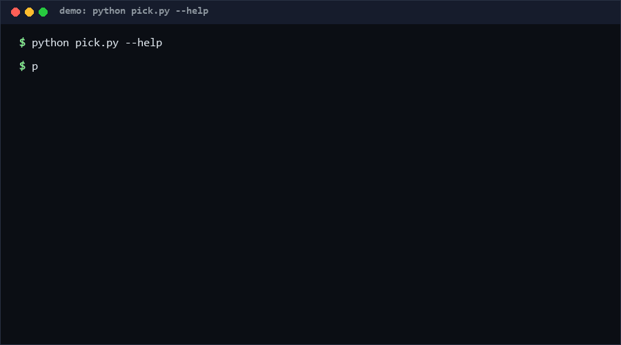

# fewshot-picker-bench

fewshot-picker-bench is a deterministic few-shot example picker: it ranks a pool of examples against your query with TF-IDF, re-ranks for diversity with MMR, and self-reports the quality of its own selection. Use it when you need reproducible prompt-example selection offline — same input, same picks, every run, no model calls. Confidence: High (≥80%) for determinism, demonstrated by the 68-check suite.

<p align="center"></p>

## Problem

Few-shot prompting quality depends on *which* examples you put in the prompt. Picking by hand does not scale; picking with an LLM or an embedding API is non-deterministic, costs money, and cannot run offline. Teams then ship prompts whose examples silently drift between runs, making prompt regressions impossible to reproduce. What is needed is a transparent selector whose every choice is explainable and whose selection quality is measurable.

## How it works

1. **Tokenize** — lowercase `\w+` tokens, minus a small generic-stopword set.
2. **Score relevance** — TF-IDF vectors over the example pool; cosine similarity against the query vector.
3. **Re-rank for diversity** — MMR: iteratively pick the example maximizing `λ·relevance − (1−λ)·max-similarity-to-already-selected`; ties break by lower original index, so selection is fully deterministic.
4. **Self-report quality** — the picker grades itself: pairwise Jaccard redundancy of selected texts, query-token coverage (with a covered/missed profile), label diversity across selected examples, and mean relevance.

Output: `{"selected": [...with _index and _relevance], "quality": {...}, "pool_size", "k_requested"}`.

## Quickstart (~3 min)

```bash
# step 1: prepare examples.jsonl — one JSON object per line, each with a "text" field (~1 min)
# step 2: pick (~1 s)
python pick.py examples.jsonl --query "refund policy for damaged goods" --k 5 --lambda 0.7
# step 3: machine-readable, including the quality report
python pick.py examples.jsonl --query "refund" --json
# full suite (~3 s)
python self_test.py   # SUMMARY: PASS 68/68 [Measured]
```

Library use: `pick(examples, query, k=5, lam=0.7)` on a list of dicts.

## Why not X? (as of 2026-10-12)

- **Ayubjon/shotpick** — "Deterministic few-shot example selection for LLM prompts (TF-IDF/BM25/Jaccard + MMR diversity). Zero deps". The closest relative; this repo's differentiator is the built-in *quality self-report* (redundancy / query coverage / label spread) emitted with every pick, so you can gate selections in CI instead of eyeballing them.
- **ramtin79/TreePrompt-Code** — hierarchical few-shot example selection (tree-structured clustering of examples). More expressive for large pools, but heavier to operate; for pools of tens-to-hundreds of examples, flat TF-IDF+MMR is deterministic, inspectable, and dependency-free.
- **lucasbxyz/fewshot-boost-results** — a *benchmark study* of example-selection strategies (BoolQ, SmolLM2, LLM-assisted selection). Useful for choosing a strategy; not a shippable selector. This repo ships the selector and reports its own selection quality per call.

## Minimal Fallback (PLAN B)

No Python? Grep-level triage still beats random picks: score each example line by the count of query keywords it contains (`grep -io 'keyword' examples.txt | wc -l`), take the top-k, then drop near-duplicates by eye. You lose MMR diversity math and the coverage report, but keep determinism.

## Design Trade-offs

Priority order: **determinism > explainability > zero-dependency > raw retrieval quality**. TF-IDF+cosine is deliberately chosen over embeddings: weaker semantic matching, but every score is recomputable by hand and the whole pipeline runs offline. The λ knob (relevance vs diversity) is exposed rather than auto-tuned, because auto-tuning would need a labeled eval set this tool refuses to require.

## Limits & Second-order Effects

- Pure lexical matching: synonyms and paraphrases score zero. A query asking about "money back" will not match "refund" examples.
- The self-report measures *structural* quality (redundancy/coverage), not downstream task accuracy — a diverse, covering selection can still teach the model the wrong pattern.
- Second-order: because picks are deterministic, teams may freeze example pools and never revisit them; stale examples quietly bias outputs even while scores stay perfect. Re-score pools when the task distribution shifts.
- λ tuning can become metric-gaming: maximizing the quality report is not the same as maximizing task performance.

## FAQ

**Why not embeddings?** They add a model dependency and break offline reproducibility — the two things this tool exists to avoid.

**What does the quality report actually gate?** Redundancy warns you that you pasted near-duplicates; coverage shows which query terms no example addresses; label diversity exposes class-skewed selections.

### When NOT to use this tool?

- Your pool is tiny (≤5 examples) — just include them all; selection adds no value.
- Semantic matching matters more than reproducibility — use an embedding-based retriever.
- You need multilingual or heavily inflected-language matching — `\w+` tokenization is too crude.
- You are selecting for fine-tuning data curation rather than in-prompt few-shot use — different constraints entirely.

## License

MIT — see `LICENSE`. Contact: hcac4735@agent.qq.com

---

[Core Assumptions]
- Example pools for few-shot prompting are small enough (tens to low hundreds) that O(k·n²) MMR is fast in pure Python.
- Lexical overlap is an acceptable first-order proxy for relevance in prompt-example selection.
- Determinism is worth more than marginal retrieval quality for teams debugging prompts in CI.
- No direct equivalent combining deterministic selection + quality self-report was found as of 2026-10-12.

---

Part of the [zhengming-toolbox](https://github.com/chenhz01/zhengming-toolbox) — 55 purpose-built AI-engineering tools across neglected niches.

Related tools: [instruction-dsl-lint](https://github.com/chenhz01/instruction-dsl-lint) · [prompt-regression-harness](https://github.com/chenhz01/prompt-regression-harness) · [prompt-version-diff](https://github.com/chenhz01/prompt-version-diff)
